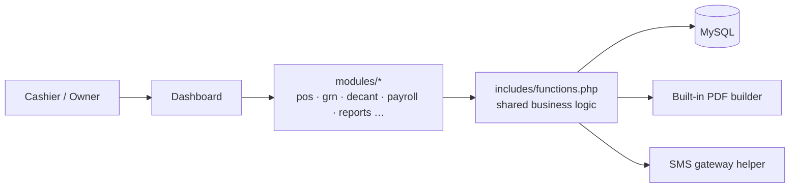

 

**Point of sale, stock and accounting built around how perfume retailers actually work.**

> 🔒 **Source code is private.** This repository is a public showcase of the project. For demos or collaboration, contact [hello@imadhimthiyas.nl](mailto:hello@imadhimthiyas.nl).

---

## Overview

Perfume POS covers the full cycle of a fragrance business: buying stock through goods-received notes, selling full bottles, **decants** and attar by volume, tracking empty bottles, managing staff payroll and keeping a ledger, with printable invoices and PDF financial reports.

## Features

| Area | What it does |
|:--|:--|
| 🛍️ **POS & Sales** | Fast checkout, sales history, customer and owner invoices |
| 🧴 **Perfumes & Brands** | Catalogue with brands, sizes and stock |
| 💧 **Decant & Attar** | Sell by volume, create and edit decants, track bottles used |
| 🫙 **Empty Bottles** | Stock and movement of empty bottles |
| 📥 **GRN** | Goods-received notes: create, edit, view, supplier stock intake |
| 🏷️ **Offers** | Promotions and discount rules |
| 🔁 **Returns** | Customer and supplier returns |
| 💰 **Cash, Credit & COD** | Cash book, credit customers and settlements, cash-on-delivery tracking |
| 🏬 **Give to Shop** | Stock handed to other shops |
| 👥 **Payroll** | Staff salary and payroll processing |
| 📒 **Ledger & Reports** | Accounting reports and financial PDFs |
| 🧾 **Invoice Designer** | Visual designer for invoice layout and logo |
| 💬 **SMS** | Customer SMS and SMS credit reload |
| ⚙️ **Admin** | Users, settings, activity log, database tools |

## Architecture

